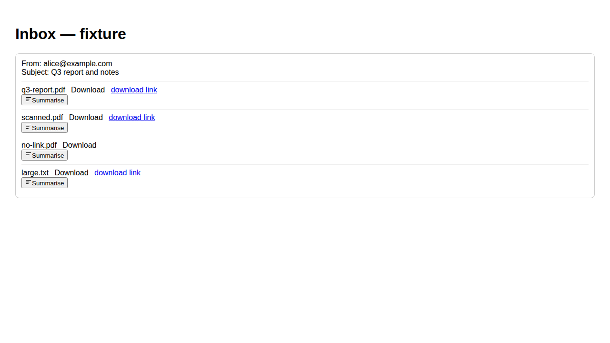
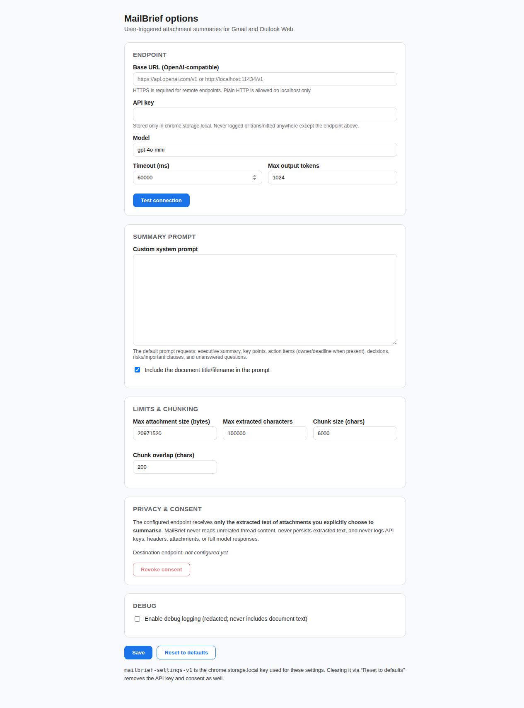
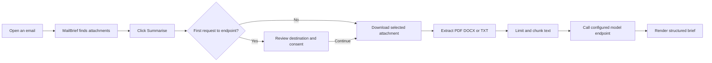

<div align="center">

# MailBrief

### Turn email attachments into clear, actionable briefs

A privacy-first Chrome extension for Gmail and Outlook Web. Select an attachment, give consent, and receive a structured summary from any OpenAI-compatible model endpoint.

[](https://github.com/GautamVhavle/MailBrief/actions/workflows/ci.yml)
[](https://developer.chrome.com/docs/extensions/develop/migrate/what-is-mv3)
[](https://www.typescriptlang.org/)
[](#verification)
[](LICENSE)

**[Install locally](#install-locally)** · **[See how it works](#how-it-works)** · **[Configure an endpoint](#configure-mailbrief)** · **[Contribute](CONTRIBUTING.md)** · **[Security](SECURITY.md)**

</div>

---

## The problem

Important information is often trapped inside email attachments. Reading every PDF, DOCX, and TXT file manually takes time and makes action items easy to miss.

## The solution

MailBrief adds a **Summarise** action beside supported attachments in Gmail and Outlook Web. It extracts only the selected document, sends the extracted text to the endpoint you configure, and displays a structured brief in the email.

> **Designed for control:** Nothing is sent automatically. MailBrief asks for consent before the first request to each configured endpoint.

## What the experience looks like

### Attachment actions



MailBrief detects supported attachments and places a summarisation action beside each file. The current fixture demonstrates PDF, scanned PDF, missing-link, and large-file states.

### Configure your endpoint



The Options page keeps endpoint, model, prompt, limits, consent, and debug controls in one place. API keys remain in Chrome local storage and are never committed to the repository.

## Highlights

| Capability | Details |
| --- | --- |
| Supported clients | Gmail, Outlook Web, Outlook Live |
| Supported files | PDF, DOCX, TXT |
| Model API | Any OpenAI-compatible `/chat/completions` endpoint |
| Summary output | Executive summary, key points, action items, decisions, risks, unanswered questions |
| Privacy | User-triggered processing, explicit consent, attachment-only extraction |
| Limits | 20 MB default file limit, 100,000 extracted-character limit, deterministic chunking |
| Extension | Chrome Manifest V3 with least-privilege host permissions |

## How it works



### What is sent

Only the extracted text from the attachment you selected, plus the document title when enabled. MailBrief does not send unrelated thread content.

### What is not stored

MailBrief does not persist raw extracted text, full model responses, authorization headers, or attachment contents. Logs are redacted by default.

## Install locally

### Requirements

- Node.js 22 or newer
- npm
- Google Chrome or Chromium

### Build the extension

```bash
git clone https://github.com/GautamVhavle/MailBrief.git
cd MailBrief
npm install
npm run build
```

### Load it in Chrome

1. Open `chrome://extensions`.
2. Turn on **Developer mode**.
3. Click **Load unpacked**.
4. Select the generated `dist/` directory.
5. Open the MailBrief **Options** page from the extension card.
6. Configure the endpoint and model before using the extension.

The packaged release can be generated with:

```bash
npm run package
```

This creates `mailbrief-0.1.0.zip` locally. Generated build files and ZIP artifacts are excluded from Git by design.

## Configure MailBrief

Open the extension Options page and set:

| Setting | What to enter |
| --- | --- |
| Base URL | Your OpenAI-compatible API base URL, such as `https://api.openai.com/v1` or a local Ollama endpoint |
| API key | The key for the configured endpoint. Leave blank if your local endpoint does not require one |
| Model | The model identifier accepted by your endpoint |
| Timeout | Maximum request time in milliseconds |
| Max output tokens | Maximum response size |
| Custom prompt | Optional instructions for your preferred summary format |

Click **Test connection**, then **Save**.

Remote endpoints must use HTTPS. Plain HTTP is accepted for localhost development endpoints.

## Use the MailBrief agent

1. Open Gmail or Outlook Web.
2. Open an email containing a PDF, DOCX, or TXT attachment.
3. Find the **Summarise** button beside the attachment.
4. Click it.
5. On the first request to an endpoint, review the destination and consent text.
6. Select the consent checkbox and click **Continue**.
7. Wait while MailBrief downloads and extracts the selected file.
8. Read the structured brief shown beside the attachment.
9. Use the action items, decisions, risks, and unanswered questions to decide what to do next.

If a scanned PDF is selected, MailBrief reports that OCR is required. OCR is intentionally not bundled in the MVP.

## Summary format

The default prompt asks the model to return:

- Executive summary
- Key points
- Action items with owners and deadlines when present
- Decisions
- Risks and important clauses
- Unanswered questions

You can replace the default prompt from Options when your team needs a different format, such as a legal review, sales brief, meeting follow-up, or procurement checklist.

## Project structure

```text
src/
├── adapters/       Gmail, Outlook, and fixture DOM adapters
├── background/     MV3 service worker and request orchestration
├── content/        Attachment controls and in-page summary UI
├── extraction/     PDF, DOCX, TXT, limits, and chunking
├── llm/            OpenAI-compatible client, prompt, parsing, errors
├── options/        Extension settings page
└── shared/         Types, storage, settings, endpoints, logging

tests/
├── browser/        Gmail, Outlook, and Options Playwright tests
├── fixtures/       Synthetic email pages and document files
└── unit/           Core extraction, settings, LLM, and security tests
```

Provider-specific DOM logic stays behind adapters so Gmail changes do not break Outlook.

## Verification

Run the core checks:

```bash
npm run lint
npm run typecheck
npm run test
npm run build
npm run package
node scripts/secret-scan.mjs dist
```

Run browser tests on Linux with Xvfb:

```bash
xvfb-run -a npm run test:browser
```

Current verified baseline:

- 77 unit tests passing
- 16 browser tests passing
- Production build passing
- Secret scan passing
- ZIP packaging passing

## Privacy and security

MailBrief is built around four rules:

1. Summarisation is user-triggered by default.
2. Only the selected attachment is downloaded and extracted.
3. Extracted text is sent only to the endpoint shown in the consent dialog.
4. Raw document text is not retained by the extension.

Read the complete [Privacy Policy](PRIVACY_POLICY.md) and [Security Policy](SECURITY.md).

## Contributing

Read [CONTRIBUTING.md](CONTRIBUTING.md) before opening a pull request. In particular:

- Do not commit keys, copied email content, generated builds, or ZIP files.
- Keep Gmail and Outlook changes in their own adapters.
- Add unit and browser coverage for behavior changes.
- Run the complete verification suite before requesting review.
- Explain permission, privacy, and network-flow changes.

## Chrome Web Store readiness

The repository includes a release checklist at [docs/CWS_CHECKLIST.md](docs/CWS_CHECKLIST.md). Before publishing, review:

- Permission declarations
- Data-use disclosures
- Privacy policy URL
- Screenshots and store description
- Support contact
- ZIP contents and manifest

## Roadmap

- OCR for scanned PDFs
- XLSX extraction
- More provider-specific attachment selectors
- Optional team summary templates
- Optional local model presets

## License

MIT. See [LICENSE](LICENSE).

<div align="center">

Built for faster, safer document review inside email.

</div>
